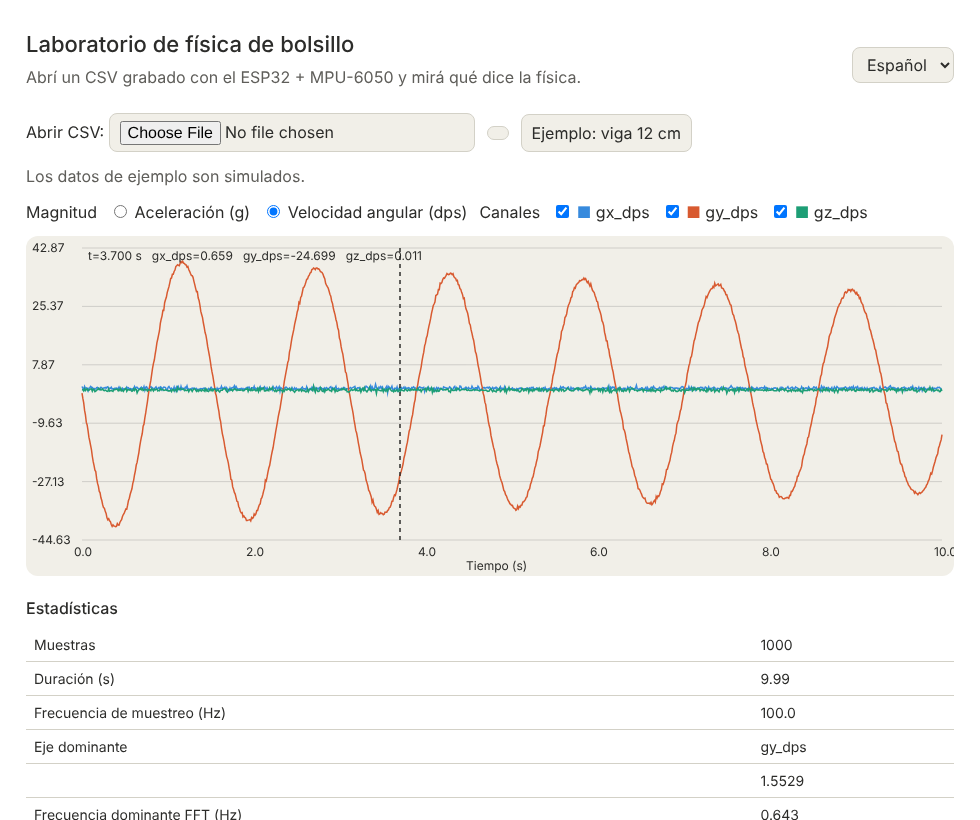
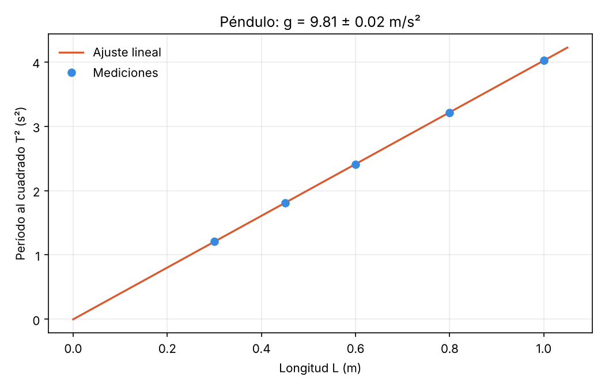
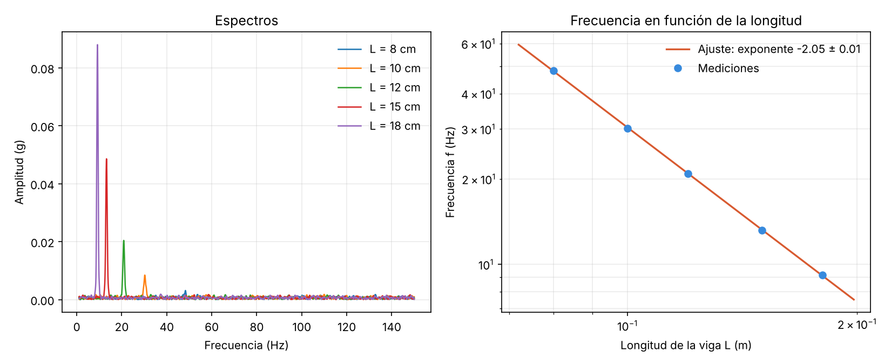

# Laboratorio de física de bolsillo con ESP32

Un ESP32 con un acelerómetro/giroscopio MPU-6050 registra movimientos; un script de Python los analiza y estima **g** con un péndulo y la **ley de potencia** de la frecuencia de una viga; un panel web permite explorar los datos; la caja y las vigas se diseñan e imprimen en 3D.

Es un proyecto de aula para escuela secundaria que integra física, programación, electrónica, diseño 3D, análisis de datos, uso responsable de IA y comunicación (incluido un resumen en inglés).



> Los datos de `datos/ejemplo/` son **simulados** (semilla fija, con ruido, sesgo del giroscopio y error de ganancia). Sirven para probar el análisis antes de medir. No son resultados experimentales.

## Qué incluye

| Carpeta | Contenido |
|---------|-----------|
| `firmware/` | Programa del ESP32 (PlatformIO, sin librerías externas: el MPU-6050 se maneja por registros) |
| `software/` | `registrar.py` (graba y descarga el CSV), `analizar.py` (péndulo y viga), `fisica.py` (funciones de análisis), `generar_ejemplo.py` |
| `panel/` | Visor web sin dependencias, en español e inglés |
| `caja/` | `caja.scad`: caja, tapa y viga paramétricas en OpenSCAD |
| `datos/ejemplo/` | Registros simulados |
| `docs/` | Cableado, materiales, guía docente, rúbrica, plantilla de registro de IA |
| `tests/` | Pruebas de Python, de JavaScript y de las funciones del firmware |

## Inicio rápido (sin hardware)

```bash
pip install -r software/requirements.txt
python software/analizar.py pendulo --archivos datos/ejemplo/pendulo_*cm.csv --quieto datos/ejemplo/quieto.csv --salida pendulo.png
python software/analizar.py vibracion --archivos datos/ejemplo/vibracion_*cm.csv --salida vibracion.png
```

Con los datos simulados da `g ≈ 9,81 ± 0,02 m/s²` y un exponente de la viga de `≈ -2,05 ± 0,01`.

| Péndulo | Viga |
|---------|------|
|  |  |

## Con el dispositivo

1. Armá el circuito (`docs/cableado.md`) y cargá el firmware: `pio run -d firmware -t upload`.
2. Grabá y descargá un experimento (cambiá el puerto: `COM3` en Windows, `/dev/ttyUSB0` en Linux):

```bash
python software/registrar.py --puerto COM3 --frecuencia 100 --segundos 10 --salida datos/mis_datos/pendulo_60cm.csv
```

También podés grabar con el pulsador (GPIO 4) y descargar después con `--solo-descargar`.

3. Registrá el dispositivo **quieto** unos segundos para calibrar y analizá con `--quieto`.
4. El nombre del archivo lleva el largo (`pendulo_60cm.csv`) y el script lo lee solo.

Comandos por serial: `g` grabar, `x` detener, `v` volcar, `f<hz>` frecuencia (20 a 1000), `s<seg>` duración.

## Panel web

Servilo desde la raíz del repositorio (los botones de ejemplo leen `datos/ejemplo/`):

```bash
python -m http.server 8000
# abrí http://localhost:8000/panel/
```

También podés abrir tu propio CSV con el selector de archivos. Muestra los canales, estadísticas, frecuencia de muestreo, eje dominante, período por cruces por cero y frecuencia del espectro.

## La caja

`caja/caja.scad` genera `caja_base`, `caja_tapa` y `viga` (cambiá la variable `parte`). Las medidas son parámetros. **No fue renderizada ni impresa todavía**: imprimí una prueba y ajustá con tu placa y tu calibre.

## Uso en el aula

Secuencia de unas 10 clases con producto en cada una (`docs/guia_docente.md`): pregunta y modelo, electrónica, firmware, calibración y ruido, péndulo para g, diseño 3D, viga y espectros, mejora del panel con IA, informe con incertidumbre y resumen en inglés, y cierre con coevaluación.

- Competencias: creatividad, comunicación, pensamiento crítico, carácter, colaboración y ciudadanía.
- Evaluación con rúbrica (`docs/rubrica.md`).
- Uso responsable de IA: registro de prompts y verificación (`docs/registro_prompts_plantilla.md`).
- La vinculación con el diseño curricular de Física depende del año y de la jurisdicción: ajustala con el profesor o la profesora del área.
- Seguridad y límites: ver la guía docente.

## Límites de las mediciones

- El MPU-6050 es un sensor modesto: ruido, deriva y error de ganancia. Por eso se calibra con un registro en reposo.
- La incertidumbre que informa el ajuste **no incluye errores sistemáticos** (largo mal medido, ángulos grandes, masa del sensor).
- El firmware nunca se probó en hardware real por quien escribió este repositorio y la compilación para ESP32 la verifica el CI; sí se verificó la sintaxis y las funciones puras en una PC.

## Pruebas

```bash
pytest tests
node --test tests/panel.test.js
g++ -std=c++17 -Wall -o prueba_conversiones tests/test_conversiones.cpp && ./prueba_conversiones
```

## Licencia

MIT. Ver `LICENSE`.
